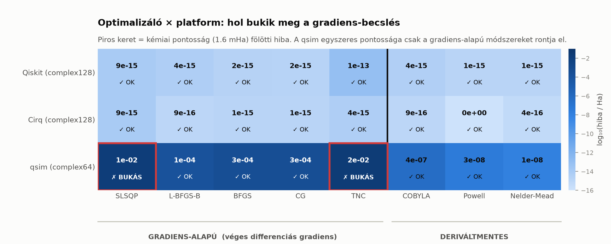
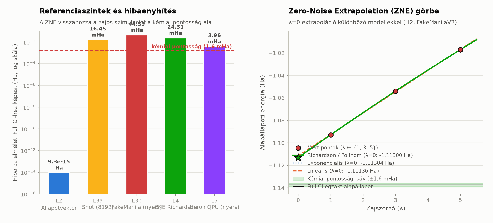
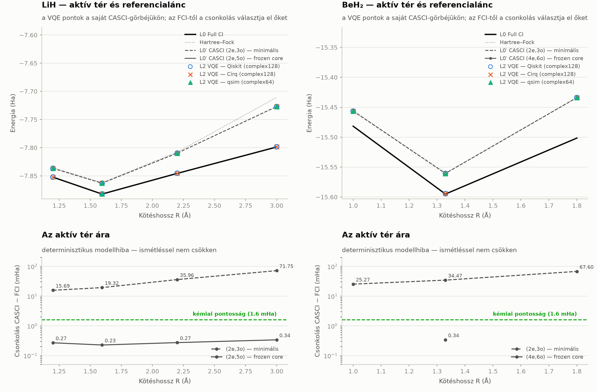
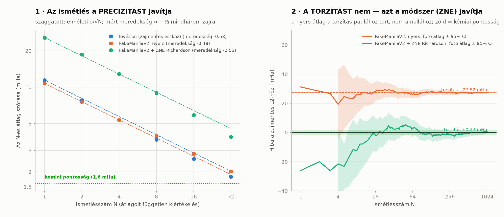
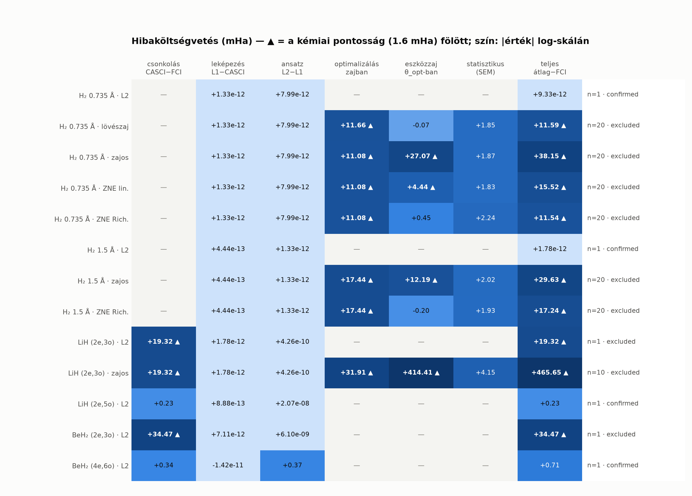
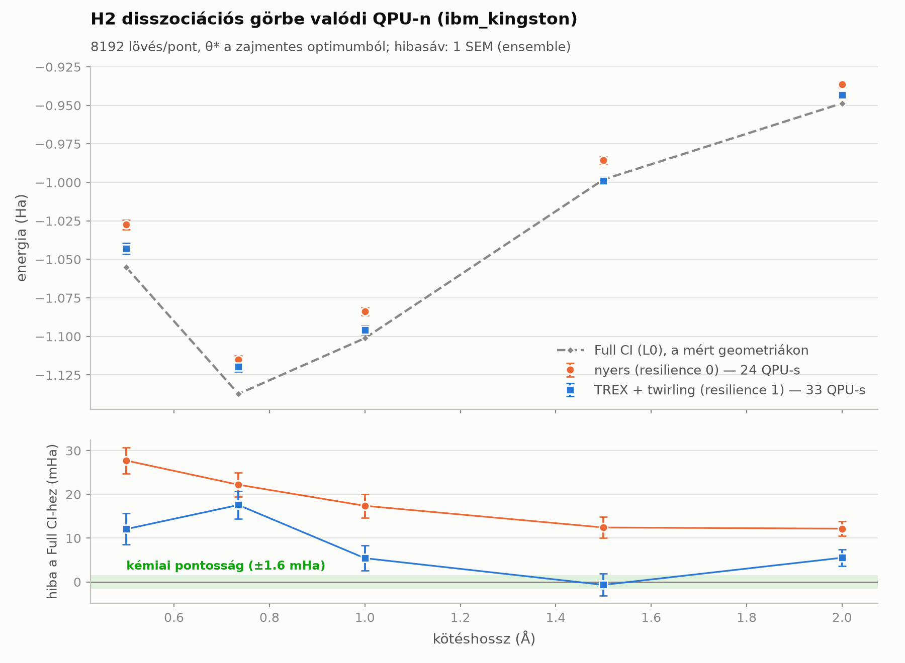

# VQEBD — Variational Quantum Eigensolver Benchmark & Dashboard

[](https://github.com/aiasz/VQEBD/actions/workflows/ci.yml)
[](https://doi.org/10.5281/zenodo.23886002)
[](LICENSE)
[](https://www.python.org/)
[](CHANGELOG.md)
[](docs/plan/00_master_plan.md)
[](docs/testing/TR-F09_publikalas.md)
[](docs/01m_multiplatform.md)

**Hivatkozás / Cite as:** Kormos, A. (2026). *VQEBD — Variational Quantum Eigensolver Benchmark & Dashboard* (v1.0.0) [szoftver / software]. Zenodo. <https://doi.org/10.5281/zenodo.23886002> · [`CITATION.cff`](CITATION.cff) · BibTeX: [HU](#hivatkozás) / [EN](#citation)

**🇭🇺 [Magyar](#magyar) | 🇬🇧 [English](#english)**

---

## Magyar

> Reprodukálható, konténerizált benchmark kis molekulák VQE-alapú
> alapállapoti-energia számítására, hibaenyhítési stratégiák összehasonlításával —
> szimulátoron és valódi IBM-kvantumhardveren.

**Szerző:** Kormos Attila · **Megvalósítás MI-eszközzel:** Claude (Anthropic)

> 🤖 **MI-vel készített kísérlet — Kormos Attila kezdeményezésével és irányításával.** Az ötletet, a célokat és a
> döntéseket, az IBM-hozzáférést és az MI-használat költségét a szerző adta; a kódot és a szövegeket az Anthropic Claude
> modelljei írták meg az ő kérésére és utasításai szerint. **Független szakmai lektorálás és külső replikáció nem történt.**
> Részletek: [`AI_DISCLOSURE.md`](AI_DISCLOSURE.md).

### Röviden

**Mit csinál?** Ugyanazt a kvantumkémiai számítást (H₂, LiH, BeH₂ alapállapoti energiája VQE-vel) futtatja
klasszikus egzakt, zajmentes, véges lövésszámú, zajos szimulátoros és valódi IBM-hardveres szinten, és a hibát
forrásaira bontja (leképezés, ansatz, statisztika, hardverzaj). Hibaenyhítési módszereket (ZNE, TREX) hasonlít össze
azonos feltételek mellett. Minden eredmény sémaverziózott adatbázisba és exportba kerül, és böngészős dashboardon
nézhető meg.

**Gyors kipróbálás** (Docker és Git kell, ~3 GB szabad lemez, x86-64 gép):

```bash
git clone https://github.com/aiasz/VQEBD.git
cd VQEBD
docker compose -f docker/docker-compose.yml build app                      # image építése (az első alkalommal több perc)
docker compose -f docker/docker-compose.yml run --rm app python -m vqebd   # első VQE-számítás (H₂), pár másodperc
docker compose -f docker/docker-compose.yml up -d dashboard                # böngészőben: http://localhost:8501
```

Példa kimenet (H₂, 0.735 Å, a második parancstól):

```text
Energiák (Hartree):
  Hartree–Fock ...... -1.1169989968
  L0  Full CI ....... -1.1373060358
  L2  VQE ........... -1.1373060358
Kémiai pontosságon belül (|Δ| < 1.6 mHa): IGEN
Variációs elv (E_VQE ≥ E_egzakt): teljesül
```

> **Windows:** a parancsok Git Bashben és PowerShellben is futnak (Windows PowerShell 5-ben a parancsokat külön
> sorokba írd). A `make` nem kötelező. Részletek és hibaelhárítás: [`docs/08_deployment.md`](docs/08_deployment.md).

**Reprodukálhatóság.** A rendszer Python 3.11-en, az alábbi **rögzített verziókkal** fut (a teljes, 101 csomagos fa:
[`requirements.lock`](requirements.lock); a Docker-build betartatja, és teszt őrzi, hogy a táblázat egyezzen a lockkal):

<!-- versions:start -->
| Csomag | Verzió |
|---|---|
| `numpy` | 1.26.4 |
| `scipy` | 1.13.1 |
| `qiskit` | 1.4.6 |
| `qiskit-aer` | 0.17.2 |
| `qiskit-nature` | 0.7.2 |
| `qiskit-ibm-runtime` | 0.41.1 |
| `pyscf` | 2.14.0 |
| `cirq-core` | 1.4.1 |
| `qsimcirq` | 0.22.1 |
| `matplotlib` | 3.11.2 |
| `pandas` | 3.0.6 |
| `streamlit` | 1.59.1 |
| `plotly` | 7.1.0 |
| `pyarrow` | 24.0.0 |
<!-- versions:end -->

A Mitiq (GPL-3.0) opcionális, a Docker-image nem tartalmazza ([`NOTICE`](NOTICE)).

### ⚠️ A projekt állapota

A projekt **`v1.0.0`**, az első publikált kiadás: a Fázis 0–9 lezárult, hátra a Fázis 10 (közösségi visszacsatolás).
A VQE-mag működik három platformon (Qiskit, Cirq, qsim), véges lövésszámmal (L3a), kalibrációs
zajmodellen (L3b), éles fizikai méréssel az IBM 156-qubites Heron QPU-ján
(`ibm_kingston`, L5), ISA-szintű Zero-Noise Extrapolation hibaenyhítéssel (L4, a
Mitiq-kel keresztvalidálva); strukturált SQLite adattárolással, batch-motorral és ismétlésen alapuló
statisztikával, hibatárolással és ütemezővel, böngészős dashboarddal és konténeres rendszerrel.

**Mit jelent az 1.0?** A rendszer reprodukálható és dokumentált, nem azt, hogy minden fizikai kérdés lezárult. Az ismert
korlátok nyíltan szerepelnek a jegyzőkönyvekben, pl.: zajos szimulációban egyik konfiguráció sem éri el a kémiai
pontosságot (`TR-F05`), a hardveres görbén csak egy pont egyeztethető vele (`TR-F05` 7.), a dashboardhoz nincs vizuális
(böngészős) ellenőrzés (`TR-F07`).

> **Fázis 5 — lezárva (2026-11-02).** Elkészült az aktív tér (LiH, BeH₂;
> CASCI-keresztvalidáció ≤ 4·10⁻¹⁴ Ha), a batch-motor, az ismétlésen alapuló
> statisztika (ADR-0007) és a séma v2. Mindkét batch lefutott (50 + 180 futás),
> a 10 elfogadási kritérium teljesült: [`TR-F05`](docs/testing/TR-F05_batch.md).
> **A hardveres H₂ disszociációs görbe (5.H)** a kiadás után, 2026-11-02-án
> lefutott az `ibm_kingston` QPU-n (57 QPU-s): a hardver a görbén nem éri el a
> kémiai pontosságot ([`TR-F05` 7.](docs/testing/TR-F05_batch.md)).

> **v0.7.1 — javítókör (2026-09-25).** A Fázis 5 előtti átvizsgálás három mérési
> hibát tárt fel és javított: (1) az Aer-mintavétel minden kiértékelésnél ugyanazt
> az eltolást adta, vagyis a „lövészaj” állandó torzítás volt; (2) a ZNE
> hajtogatását a transzpiler részben kiejtette; (3) a hardveres mérés
> bizonytalansága és mitigációs szintje (TREX) nem volt rögzítve. A korábban
> közölt „ZNE → +0.35 mHa ✅” a TR-000 spike száma volt, nem a leszállított
> kódé. **Az alábbi értékek már a javított kóddal mértek.** Részletek:
> [`CHANGELOG.md`](CHANGELOG.md), [TR-F03 v1.1.0](docs/testing/TR-F03_mitigation.md).

| Fázis | Tartalom | Állapot |
|---|---|---|
| 0 | Repó + Docker alapinfrastruktúra | ✅ **Lezárva** (`v0.1.0`) |
| 1 | H2-VQE szimulátoron | ✅ **Lezárva** (`v0.2.0`) |
| **1M** | **Többplatformos validáció (Qiskit ↔ Cirq ↔ qsim)** *(ADR-0006)* | ✅ **Lezárva** (`v0.3.0`) |
| **1b** | **Zajos szimuláció FakeBackend-en (L3a / L3b)** | ✅ **Lezárva** (`v0.4.0`) |
| **2** | **Egyszeri futás valódi IBM-hardveren (`ibm_kingston` Heron QPU, L5)** | ✅ **Lezárva** (`v0.5.0`) |
| **3** | **Hibaenyhítés (ISA ZNE + Mitiq keresztvalidáció, L4)** | ✅ **Lezárva** (`v0.6.0`) |
| **4** | **Adatséma és perzisztens tárolás (SQLite / CSV / JSON)** | ✅ **Lezárva** (`v0.7.0`) |
| **5** | **Batch futtatás, aktív tér (LiH, BeH2), statisztika** | ✅ **Lezárva** (`v0.8.1`) |
| **6** | **Automatizálás, hibatárolás, ütemezés** | ✅ **Lezárva** (`v0.9.0`) |
| **7** | **Streamlit dashboard** | ✅ **Lezárva** (`v0.10.0`) |
| **8** | **Konténeres rendszer, a dashboard egyparancsos indítása** | ✅ **Lezárva** (`v0.11.0`) |
| **9** | **Dokumentáció, validálás, publikálás (Zenodo DOI)** | ✅ **Lezárva** (`v1.0.0`) — DOI: [10.5281/zenodo.23886002](https://doi.org/10.5281/zenodo.23886002) |
| 10 | Közösségi visszacsatolás | ⬜ Tervezett |

### Mit old meg ez a projekt?

A NISQ-korszakban egy VQE-eredmény önmagában értelmezhetetlen: ha egy energiaérték
eltér a valóditól, **nem tudjuk, mi okozta** — a fermion→qubit leképezés, az
ansatz korlátai, a véges lövésszám vagy a hardverzaj.

A VQEBD ezért **öt referenciaszinten** futtatja ugyanazt a számítást, és a
hibaforrásokat külön-külön számszerűsíti:

```
 L0  FCI (klasszikus egzakt)
  │  ← leképezési hiba
 L1  a qubit-Hamilton-operátor egzakt legkisebb sajátértéke
  │  ← ansatz-hiba
 L2  VQE zajmentes állapotvektoron
  │  ← statisztikus (shot-) zaj
 L3a VQE véges lövésszámmal
  │  ← hardverzaj
 L3b VQE zajos szimulátoron / valódi QPU-n
  │  ← hibaenyhítés
 E_mitigated
```

Mért példa (H2, 0.735 Å, STO-3G, `FakeManilaV2` zajmodell, a zajmentes optimumban,
`v0.7.1` — részletek: [TR-F03](docs/testing/TR-F03_mitigation.md)):

| Szint | Hiba a Full CI-hez | Mit mutat |
|---|---|---|
| L1 — egzakt diagonalizáció | 1.3 × 10⁻¹⁵ Ha | leképezési hiba |
| L2 — VQE (állapotvektor) | ~10⁻¹⁴ Ha | ansatz-hiba |
| L3b — zajos, nyers (egzakt várható érték) | +27.5 mHa ❌ | kapuzaj |
| L4 — ZNE Richardson, **torzítás** | **+0.23 mHa ✅** | a módszer rendszeres hibája |
| L4 — ZNE Richardson, **1 futás, 8192 lövés** | −5.7 **± 26.2** mHa | a lövészajt 2.28× felerősíti |
| L5 — `ibm_kingston`, 1 mérés, TREX | −4.0 **± 12.5** mHa | FCI-vel összeférhető, de a felbontás ≫ kémiai pontosság |

*(✅ = kémiai pontosságon belül, |Δ| < 1.6 mHa; ± = 50 seed szórása, ill. a
hardveres ensemble standard hiba)*

#### Fázis 1 — mért eredmény (H2, 0.735 Å, STO-3G, zajmentes)

| Szint | Energia (Ha) | Hiba |
|---|---|---|
| Hartree–Fock | −1.1169989968 | — |
| **L0 — PySCF Full CI** | **−1.1373060358** | referencia |
| **L1 — egzakt diagonalizáció** | **−1.1373060358** | leképezés: **+1.33 × 10⁻¹⁵ Ha** |
| **L2 — VQE** | **−1.1373060358** | ansatz: **+7.99 × 10⁻¹⁵ Ha** |

**Visszanyert korrelációs energia: 100.000000 %.** A hiba a kémiai pontosság
(1.59 × 10⁻³ Ha) nagyjából 10⁻¹²-szerese. Három leképezés (Jordan–Wigner,
paritás, Bravyi–Kitaev) egymástól függetlenül ugyanezt adja.

Részletek: [`docs/testing/TR-F01_vqe_mag.md`](docs/testing/TR-F01_vqe_mag.md).

### Fázis 1M — három platform, egyetlen eredmény

| Platform | Optimalizáló | E (Ha) | Eltérés a Qiskittől |
|---|---|---|---|
| `qiskit_statevector` | SLSQP | −1.137306035753 | referencia |
| `cirq_simulator` | SLSQP | −1.137306035753 | **4.4 × 10⁻¹⁶** |
| `qsim` | Powell | −1.137306006762 | **2.9 × 10⁻⁸** |



**A fázis legfontosabb felfedezése:** a **gradiens-alapú optimalizálók csendben
téves minimumot találnak** egyszeres pontosságú (`complex64`) platformon. A SciPy
véges-differencia lépésköze `1.49 × 10⁻⁸`, a qsim célfüggvény-zaja viszont
`1.13 × 10⁻⁷` — nagyobb a lépésköznél, ezért a becsült gradiens **8
nagyságrenddel** téved. Az `SLSQP` a qsimen `1.5 × 10⁻²` Ha hibát ad
(„sikeresen konvergált" állapotban), a `Powell` viszont `2.9 × 10⁻⁸`-at.

**Ez egyetlen platformon nem derülhetett volna ki** — Qiskiten és Cirqen mind a
nyolc optimalizáló hibátlan. Részletek és az ábrák:
[`docs/01m_multiplatform.md`](docs/01m_multiplatform.md).

### Fázis 1b — véges lövésszám és hardver-zajszimuláció

| Szint | Backend | Optimalizáló | E (Ha) | Hiba az L1-hez |
|---|---|---|---|---|
| **L3a** | `qiskit_aer_shot` (8192 shot) | COBYLA | −1.1105387727 | +26.8 mHa |
| **L3b** | `qiskit_aer_noisy` (FakeManilaV2) | COBYLA | −1.0954609696 | +41.9 mHa |

*`v0.7.1` értékek (`python -m vqebd --backend <b> --optimizer COBYLA`). A `v0.7.0`
L3a-értéke (+15.9 mHa) egy állandó mintavételi eltolás volt — TR-F01B 6. szakasz.*

A Fázis 1b szétválasztja a véges mintavételi (shot) zajt és az eszköz kalibrációs
zaját (kapuhiba, T1/T2 dekoherencia). **A kiolvasási hibát az Aer Estimator nem
modellezi** (mérve, ADR-0003 1. kiegészítés). **Fontos korlát:** a H₂ teljes
korrelációs energiája (20.3 mHa) csak ~1.8σ egyetlen 8192 lövéses kiértékelés
zajához képest, ezért egyetlen zajos VQE-futás ezt nem tudja megbízhatóan
feloldani. Ez a Fázis 5 több-seedes módszertanának oka.
Részletek: [`docs/01b_noisy_simulation.md`](docs/01b_noisy_simulation.md).

### Fázis 2 — valódi hardveres mérés (IBM Heron QPU)

| Szint | Backend | Mód | E (Ha) | Hiba az L0-hoz |
|---|---|---|---|---|
| **L5** | `ibm_kingston` (156 qubit Heron r2) | 1 kiértékelés θ*-nál, 8192 shot, **TREX** | **−1.1413** | **−3.96 ± 12.5 mHa** (ensemble SE) |

Job `dapq25kak42c73cj1hu0`, **15 QPU-másodperc**. A mérés **nem nyers**: a szerver
alapértelmezett mitigációja (`resilience_level=1`, TREX mérésmitigáció +
mérés-twirling) futott. A v0.7.1 óta ez explicit paraméter. A variációs határ
alatti érték 0.3σ-s statisztikus ingadozás. A mérés FCI-vel összeférhető, de
kémiai pontosságot sem igazolni, sem cáfolni nem tud (≈ 62× több lövés kellene).
Részletek: [`TR-F02 v1.1.0`](docs/testing/TR-F02_hardware_run.md).

### Fázis 3 — hibaenyhítés Zero-Noise Extrapolation-nel (ZNE)

| Mérés | Nyers | Richardson | Exponenciális | Lineáris |
|---|---|---|---|---|
| **Torzítás** — `zne_local` (ISA-hajtogatás) | +27.52 | **+0.23 ✅** | **+0.15 ✅** | +3.15 |
| **Torzítás** — `zne_mitiq` (logikai hajtogatás) | +37.57 | **+0.37 ✅** | **+0.17 ✅** | +5.43 |
| **1 futás RMSE** (50 seed, 8192 lövés/pont) | 28.6 | 26.5 | 77.7 | **12.3** |

*(mHa, a Full CI-hez; torzítás = egzakt zajos várható érték, `precision=0`)*

A ZNE **módszere helyes**: a torzítás a kémiai pontosságon belül van, és két
független implementáció 0.13 mHa-en belül ugyanoda jut. Egyetlen futás
szórását viszont az extrapoláció felnagyítja, ezért **8192 lövésnél a lineáris
extrapoláció adja a legkisebb teljes hibát**. Az extrapolátor választása tehát a
lövésszám függvénye.
Részletek: [`docs/03_mitigation_test.md`](docs/03_mitigation_test.md).



### Fázis 4 — adatséma és perzisztens tárolás (SQLite & FAIR export)

A VQEBD a számítási eredményeket közvetlenül típusos, indexelt SQLite adatbázisba
menti (`data/db/vqebd.sqlite`), amelyből determinisztikusan reprodukálható CSV és
JSON exportok készülnek. A verziózott referencia-export:
[`docs/figures/data/results_v1.json`](docs/figures/data/results_v1.json) (`v0.7.1`).

| Tárolt futás | Backend | Mitigáció | E (Ha) | Hiba az L0-hoz |
|---|---|---|---|---|
| **L2** | `qiskit_statevector` / `cirq_simulator` | none | −1.1373060358 | < 10⁻¹⁴ Ha ✅ |
| **L2** | `qsim` (Powell) | none | −1.1373060068 | 2.9 × 10⁻⁸ Ha ✅ |
| **L3a** | `qiskit_aer_shot` (COBYLA, 50 it.) | none | −1.1421267225 | −4.8 mHa ¹ |
| **L3b** | `qiskit_aer_noisy` (COBYLA, 50 it.) | none | −1.1145306932 | +22.8 mHa |
| **L4** | `qiskit_aer_noisy` | zne_local (Rich.) | −1.1075860081 | +29.7 mHa |
| **L5** | `ibm_kingston` | ibm_resilience_1 (TREX) | −1.1412691258 | −4.0 mHa ² |

¹ statisztikus: egyetlen zajos végponti húzás, σ ≈ 11 mHa (TR-F01B 6.3) · ² 1σ-n belül (TR-F02)

Részletek: [`docs/04_data_schema.md`](docs/04_data_schema.md), [`TR-F04 v1.1.0`](docs/testing/TR-F04_storage.md).


### Fázis 5 — batch-futtatás, aktív tér és ismétlésen alapuló statisztika

A zajos futás eredménye valószínűségi változó, ezért a Fázis 5 **N seeddel és K
friss kiértékeléssel** méri, és a hibát konfidenciaintervallummal (95%, Student-t)
osztályozza a kémiai pontossághoz (±1.6 mHa) képest.

| Mért konfiguráció (H₂, N = 20 seed) | Hiba a Full CI-hez (95% CI) | Besorolás |
|---|---|---|
| lövészaj | +11.6 mHa [+7.7, +15.5] | `excluded` |
| zajos (FakeManilaV2) | +38.2 mHa [+34.2, +42.1] | `excluded` |
| zajos + ZNE (Richardson) | +11.5 mHa [+6.8, +16.2] | `excluded` |

- **Egyik zajos konfiguráció sem kémiailag pontos**, és ezt a CI ki is zárja.
- **Az ismétlés a szórást N^−½ szerint csökkenti, a torzítást nem** (mért
  meredekség −0.48 … −0.55). A torzítás ellen a módszer (ZNE) hat.
- **Aktív tér:** a frozen core LiH (2e,5o) 8 qubiten 0.23 mHa, BeH₂ (4e,6o) 10
  qubiten 0.34 mHa csonkolással kémiai pontosságon belül marad; a minimális
  (2e,3o) tér 15–72 mHa-t veszít.
- **Ismert korlát:** LiH (2e,3o) zajosan +466 mHa (az UCCSD mélységi fala).
- **Valódi QPU (5.H):** H₂ görbe 5 geometrián (`ibm_kingston`, 8192 lövés): nyers
  hiba +12 … +28 mHa, TREX-szel +5 … +18 mHa; csak az R = 1.5 Å pont egyeztethető
  össze a kémiai pontossággal (−0.68 ± 2.52 mHa). Pontonként egyetlen futás.






Részletek: [`docs/05_batch.md`](docs/05_batch.md), [`TR-F05`](docs/testing/TR-F05_batch.md).

### Fázis 6 — automatizálás, hibatárolás és ütemezés

A felügyelet nélküli működés három garanciát igényel: **a hiba nem vész el**, **az újrapróbálás nem
fogyaszt kvótát**, és **a titok nem szivárog**.

- **Hibatárolás:** minden sikertelen futás sor a `run_failures` táblában (séma v3), titoktalanított
  üzenettel, a próbálkozás sorszámával és hibaosztállyal.
- **Újrapróbálkozás:** csak az *átmeneti* hibát (hálózat, időtúllépés, HTTP 429/5xx), legfeljebb 3-szor,
  exponenciális visszalépéssel; az ismeretlen hiba **tartós**. A próbálkozásszám az adatbázisban él,
  ezért egy újraindított folyamat nem ismétel végtelenül.
- **Pipeline és ütemező:** `scripts/run_pipeline.py` (batch → export → összegzés, JSON-soros napló) és a
  `scheduler` compose-szolgáltatás átfedés elleni zárral.
- **A valódi QPU nincs ütemezve:** az ütemező csak szimulátort indít; hardverhez `--allow-hardware` **és**
  `VQEBD_ALLOW_HARDWARE=true` kell, batch szintű kvótakapuval és 1 próbálkozással (a K7 tanulsága).

```bash
python scripts/run_pipeline.py --preset f5-smoke --db data/db/pipeline.sqlite
docker compose -f docker/docker-compose.yml up -d scheduler
```

Részletek: [`docs/06_automation.md`](docs/06_automation.md), [`TR-F06`](docs/testing/TR-F06_automatizalas.md).

### Fázis 7 — dashboard

Egy csak olvasó, interaktív felület (Streamlit + Plotly) a tárolt eredményekhez, **négy nézettel**: táblázat
(és a hibák), disszociációs görbe molekulaválasztóval, módszer-összehasonlító sávdiagram (referencia, nyers,
mitigált) és körméret × módszer hőtérkép. Három adatforrást ismer (SQLite, batch-export, teljes rekordlista),
ezért egy tiszta klónon a verziózott JSON-okból is megjeleníti az adatot.

- **A közölt számokkal egyezik:** a módszer-összehasonlítás H₂ 0.735 Å-nél +11.59 / +38.15 / +15.52 / +11.54 mHa
  (lövészaj / zajos / ZNE lineáris / ZNE Richardson), pontosan a TR-F05 értékei.
- **Reprodukálható build:** a Docker-build mostantól betartatja a `requirements.lock`-ot (101 csomag, 0 eltérés);
  korábban egy újraépített image a 71 lockolt csomagból 21-ben eltért.
- **Mért függőségi kényszer:** a `pyarrow` 26.0.0 NumPy ≥ 2-t követel, a 25.0.0 pedig szegmentációs hibával
  omlik össze szálváltás után; a pin 24.0.0, védőtesztekkel.
- **Korlát:** nincs vizuális (böngészős) ellenőrzés; az ábrákat adatszinten teszteltük.

```bash
docker run --rm -p 8501:8501 -v "$PWD:/repo" -w /repo -e PYTHONPATH=/repo/src \
  -e VQEBD_DASHBOARD_ROOT=/repo vqebd:1.0.0 \
  python -m streamlit run dashboard/app.py --server.address 0.0.0.0
```

Részletek: [`docs/07_dashboard.md`](docs/07_dashboard.md), [`TR-F07`](docs/testing/TR-F07_dashboard.md).

### Fázis 8 — konténeres rendszer, a dashboard egyparancsos indítása

A Compose-rendszer három szolgáltatásból áll (`app`, `scheduler`, `dashboard`), egy image-ből és egy közös adat-volume-ból.
**A dashboard a saját gépeden, konténerben fut, egyetlen paranccsal:**

```bash
git clone https://github.com/aiasz/VQEBD.git && cd VQEBD
docker compose -f docker/docker-compose.yml up -d --build dashboard     # vagy: make dashboard
```

Utána: **<http://localhost:8501>**. Leállítás: `docker compose -f docker/docker-compose.yml stop dashboard`.

- **Biztonságos alapbeállítás:** a dashboardnak nincs hitelesítése, ezért a port csak a gazdagép hurokcímére
  (`127.0.0.1`) kötött; a szolgáltatás nem kap tokent és hardverengedélyt, a kód- és export-mountok csak olvashatók.
- **Kevés erőforrás:** üresjáratban ~66 MiB RAM, egy munkamenet ~170 MB; az image 2.19 GB.
- **Tiszta klónból igazolt:** gyorsítótár nélküli build, `pip freeze` ↔ lock 0 eltérés, a dashboard `healthy`, és a
  konténerben megtalálja az ütemező adatbázisát és a verziózott exportokat.
- **Korlát:** a „tiszta gép" ugyanaz a gép volt (másik gépen vagy VM-en nem próbáltuk).

Részletek: [`docs/08_deployment.md`](docs/08_deployment.md), [`TR-F08`](docs/testing/TR-F08_konteneres_rendszer.md).

### Gyors indítás

```bash
git clone https://github.com/aiasz/VQEBD.git
cd VQEBD
make build      # Docker-image építése
make test       # teljes tesztkészlet (772 teszt, 1 kihagyott)
```

Az első kvantumszámítás futtatása:

```bash
docker run --rm vqebd:1.0.0 python -m vqebd
```

Make nélkül (pl. Windows PowerShell):

```powershell
docker build --platform linux/amd64 -f docker/Dockerfile -t vqebd:1.0.0 .
docker run --rm vqebd:1.0.0 python -m vqebd
```

A **dashboard** indítása (egyparancsos, a saját gépen): lásd a *Fázis 8* szakaszt fent, vagy `make dashboard`.

Részletes útmutató: **[`docs/00_setup.md`](docs/00_setup.md)** (Fázis 0), a konténeres rendszerhez: **[`docs/08_deployment.md`](docs/08_deployment.md)**

### Dokumentáció

| Dokumentum | Tartalom |
|---|---|
| [`docs/plan/00_master_plan.md`](docs/plan/00_master_plan.md) | **Bővített mesterterv** — architektúra, referenciaszintek, politikák, kockázatok |
| [`docs/plan/phase_00.md`](docs/plan/phase_00.md) | A Fázis 0 részletes terve |
| [`docs/plan/phase_01.md`](docs/plan/phase_01.md) | A Fázis 1 részletes terve |
| [`docs/plan/phase_01m.md`](docs/plan/phase_01m.md) | A Fázis 1M részletes terve |
| [`docs/plan/phase_01b.md`](docs/plan/phase_01b.md) | A Fázis 1b részletes terve |
| [`docs/plan/phase_02.md`](docs/plan/phase_02.md) | A Fázis 2 részletes terve |
| [`docs/plan/phase_03.md`](docs/plan/phase_03.md) | A Fázis 3 részletes terve |
| [`docs/plan/phase_04.md`](docs/plan/phase_04.md) | A Fázis 4 részletes terve |
| [`docs/plan/phase_05.md`](docs/plan/phase_05.md) | A Fázis 5 részletes terve |
| [`docs/plan/phase_06.md`](docs/plan/phase_06.md) | A Fázis 6 részletes terve |
| [`docs/plan/phase_07.md`](docs/plan/phase_07.md) | A Fázis 7 részletes terve |
| [`docs/plan/phase_08.md`](docs/plan/phase_08.md) | A Fázis 8 részletes terve |
| [`docs/plan/phase_09.md`](docs/plan/phase_09.md) | A Fázis 9 részletes terve |
| [`docs/plan/phase_11.md`](docs/plan/phase_11.md) | **A Fázis 11 terve (jóváhagyásra vár):** a Heron-zajmodell validálása, a hardveres mérések az ingyenes keretbe darabolva |
| [`docs/01m_multiplatform.md`](docs/01m_multiplatform.md) | **Többplatformos validáció: mit ad, és mit nem** |
| [`docs/01b_noisy_simulation.md`](docs/01b_noisy_simulation.md) | **Zajos és véges lövésszámú szimuláció (L3a / L3b)** |
| [`docs/02_hardware_run.md`](docs/02_hardware_run.md) | **Valódi hardveres futtatás IBM Heron QPU-n (L5)** |
| [`docs/03_mitigation_test.md`](docs/03_mitigation_test.md) | **Hibaenyhítés és Zero-Noise Extrapolation (L4)** |
| [`docs/04_data_schema.md`](docs/04_data_schema.md) | **Adatséma, SQLite adattárolás és FAIR exportálás** |
| [`docs/05_batch.md`](docs/05_batch.md) | **Batch-futtatás, aktív tér és statisztika** |
| [`docs/06_automation.md`](docs/06_automation.md) | **Automatizálás, hibatárolás, újrapróbálkozás, ütemezés** |
| [`docs/07_dashboard.md`](docs/07_dashboard.md) | **A dashboard: nézetek, adatforrások, indítás** |
| [`docs/08_deployment.md`](docs/08_deployment.md) | **Konténeres rendszer, a dashboard egyparancsos indítása, biztonság** |
| [`docs/09_publishing.md`](docs/09_publishing.md) | **Kiadás, GitHub Release, Zenodo, DOI** |
| [`docs/01_vqe_core.md`](docs/01_vqe_core.md) | **A VQE-mag: használat, architektúra, korlátok** |
| [`docs/00_setup.md`](docs/00_setup.md) | Telepítés, futtatás, hibaelhárítás |
| [`docs/10_literature_positioning.md`](docs/10_literature_positioning.md) | **Szakirodalmi pozicionálás** — hová illik a VQEBD a hasonló benchmarkok között (nem szisztematikus áttekintés) |
| [`AI_DISCLOSURE.md`](AI_DISCLOSURE.md) | **MI-felhasználási nyilatkozat** (HU/EN) |
| [`docs/references.md`](docs/references.md) | **59 hivatkozás, 57 gépileg DOI-validálva** |
| [`docs/adr/`](docs/adr/) | Architektúra-döntések (ADR-0001…0009) |
| [`docs/testing/`](docs/testing/) | Teszttervek és mérési jegyzőkönyvek |

#### Architektúra-döntések

| ADR | Döntés |
|---|---|
| [0001](docs/adr/ADR-0001-technologiai-stack.md) | A stack Qiskit **1.4.6**-ra rögzítve — a Mitiq 0.47.0 `numpy<2.0`-t követel, a Qiskit 2.x `numpy>=2.0`-t |
| [0002](docs/adr/ADR-0002-sajat-vqe-hurok.md) | Saját VQE-hurok **V2 primitívekkel**, `qiskit-algorithms` nélkül → Qiskit 2.x-re átvihető |
| [0003](docs/adr/ADR-0003-mitigacios-architektura.md) | Pluginalapú hibaenyhítés, **saját ISA-biztos ZNE** (a Mitiq ISA-áramkörön qubiteket veszít) |
| [0004](docs/adr/ADR-0004-adattarolas.md) | SQLite kanonikus tároló, sémaverziózással, FAIR-elvek szerint |
| [0005](docs/adr/ADR-0005-determinizmus.md) | Minden véletlenforrás explicit seedet kap, és rekordba kerül |
| [0006](docs/adr/ADR-0006-tobbplatformos-architektura.md) | **A platform önálló benchmark-dimenzió** — Qiskit ↔ Cirq ↔ qsim |
| [0007](docs/adr/ADR-0007-batch-statisztika.md) | **Ismétlésen alapuló statisztika és hibaköltségvetés** — N seed × K friss kiértékelés, t-CI |
| [0008](docs/adr/ADR-0008-hibakezeles-es-utemezes.md) | **A hiba is adat** — tárolt hibák, osztályozott újrapróbálás, a valódi QPU nincs ütemezve |
| [0009](docs/adr/ADR-0009-dashboard-architektura.md) | **A dashboard** — Streamlit + Plotly, tiszta adat- és ábraréteg, csak olvasás |

### Módszertani alapelvek

1. **Egyetlen fázis sem zárható le, amíg az elfogadási kritériuma dokumentáltan nem teljesül.**
2. **Minden fázis terve a megvalósítás előtt készül el**, és a mérési jegyzőkönyve utána — mindkettő verziózva.
3. **Három tesztkör fázisonként:** funkcionális → robusztussági → keresztvalidációs.
4. **Minden szám mért, nem becsült.** A dokumentációban szereplő értékek reprodukálható mérésekből származnak, a szkriptek a repóban vannak.
5. **A hivatkozások gépileg validáltak.** A `scripts/gen_references.py` a Crossref és DataCite API-ból oldja fel a bibliográfiai adatokat — a szerzőlistákat, címeket és évszámokat nem kézzel írjuk.

### Licenc és harmadik felek szoftverei

A VQEBD saját kódja **MIT** licencű — lásd [`LICENSE`](LICENSE). A harmadik felek szoftvereit és a Mitiq
(GPL-3.0) megjegyzést a [`NOTICE`](NOTICE) tartalmazza.

> **⚠️ Mitiq (GPL-3.0).** A Mitiq csomag GPL-3.0 licencű. A VQEBD **nem linkeli be
> és nem terjeszti újra**: opcionális, futásidőben betöltött komponensként
> használja, egyetlen modulba zárva (`src/vqebd/mitigation/mitiq_zne.py`).
> **Mitiq nélkül a rendszer teljes funkcionalitással működik.** Részletek:
> [ADR-0003](docs/adr/ADR-0003-mitigacios-architektura.md). Opcionális telepítés
> (a `zne_mitiq` keresztvalidációhoz): `pip install -r requirements-mitiq.txt`.

A felhasznált szoftverek teljes listája licencekkel és hivatkozásokkal:
[`docs/references.md`](docs/references.md).

### Biztonság

**Soha ne commitolj IBM API-tokent.** A védelem három rétegű, és automatikus teszt
őrzi (`tests/repo/test_secrets_hygiene.py`):

1. `.gitignore` — a titkok nem kerülnek verziókezelésbe;
2. `.dockerignore` — a titkok nem kerülnek az image rétegeibe;
3. tartalmi ellenőrzés — tokennek látszó string keresése a verziózott fájlokban.

A tokent a `.env` fájlba tedd (`cp .env.example .env`). A valódi hardverre küldést
külön biztonsági kapcsoló védi: `VQEBD_ALLOW_HARDWARE=false` az alapértelmezés. Sebezhetőség jelentése:
[`SECURITY.md`](SECURITY.md).

### Hivatkozás

Ha a projektet használod, hivatkozz rá a [`CITATION.cff`](CITATION.cff) szerint (GitHub: *Cite this repository*).
**Zenodo DOI:** [10.5281/zenodo.23886002](https://doi.org/10.5281/zenodo.23886002) (a projekt minden verziójára;
a `v1.0.0` pontos pillanatképe: [10.5281/zenodo.23886003](https://doi.org/10.5281/zenodo.23886003)).
A kiadás menete: [`docs/09_publishing.md`](docs/09_publishing.md).

```bibtex
@software{vqebd,
  author  = {Kormos, Attila},
  title   = {{VQEBD} -- Variational Quantum Eigensolver Benchmark \& Dashboard},
  year    = {2026},
  version = {1.0.0},
  doi     = {10.5281/zenodo.23886002},
  url     = {https://github.com/aiasz/VQEBD},
  license = {MIT}
}
```

### MI-felhasználás

A projekt **MI-vel készített kísérlet**, amelyet Kormos Attila kezdeményezett és irányított: ő adta az ötletet, a célokat, a
döntéseket, az IBM-hozzáférést és az MI-használat költségét, jóváhagyta a lépéseket (a hardveres futtatásokat blokkonként
külön), és hozta a kiadási döntéseket. A kódot, a terveket és a szöveget a Claude (Sonnet 5.5, Opus 5, Opus 5.5; Claude Code)
írta meg az ő kérésére és utasításai szerint; a futtatásokat és az elemzést is a Claude végezte el, a szerző engedélyével. Ami **nem** történt meg: független szakértői lektorálás, külső replikáció, a hivatkozott művek teljes szövegének
emberi átolvasása; a hardveres eredmények pontonként egyetlen futásúak. A tudományos újdonságot nem állítjuk
([`docs/10_literature_positioning.md`](docs/10_literature_positioning.md)). A teljes, pontos nyilatkozat, a dokumentált MI-hibákkal
és egy cikkbe szánt szövegjavaslattal: [`AI_DISCLOSURE.md`](AI_DISCLOSURE.md).

### Közreműködés

Hibajelzést és javaslatot a [GitHub Issues](https://github.com/aiasz/VQEBD/issues) között várunk (sablonokkal).
A szabályokat, a fejlesztői környezetet és a minőségi kapukat a [`CONTRIBUTING.md`](CONTRIBUTING.md) írja le.
A commit-üzenetek a [Conventional Commits](https://www.conventionalcommits.org/) konvenciót követik.

---

## English

> A reproducible, containerized benchmark for VQE-based ground-state energy
> calculations of small molecules, comparing error-mitigation strategies —
> on simulators and on real IBM quantum hardware.

**Author:** Attila Kormos · **Implemented with an AI tool:** Claude (Anthropic)

> 🤖 **AI-assisted experiment — initiated and directed by Attila Kormos.** The idea, goals and decisions, the IBM access and
> the cost of the AI use came from the author; the code and text were written by Anthropic's Claude models at the author's
> request and following the author's instructions. **No independent expert review or external replication has taken place.**
> Details: [`AI_DISCLOSURE.md`](AI_DISCLOSURE.md).

### In short

**What does it do?** It runs the same quantum-chemistry calculation (ground-state energy of H₂, LiH, BeH₂ with VQE) at
classical-exact, noiseless, finite-shot, noisy-simulator and real IBM-hardware levels, and decomposes the error into its
sources (mapping, ansatz, statistics, hardware noise). It compares error-mitigation methods (ZNE, TREX) under identical
conditions. Every result goes into a schema-versioned database and export, and can be inspected in a browser dashboard.

**Quick try** (needs Docker and Git, ~3 GB free disk, an x86-64 machine):

```bash
git clone https://github.com/aiasz/VQEBD.git
cd VQEBD
docker compose -f docker/docker-compose.yml build app                      # build the image (several minutes the first time)
docker compose -f docker/docker-compose.yml run --rm app python -m vqebd   # first VQE calculation (H₂), a few seconds
docker compose -f docker/docker-compose.yml up -d dashboard                # in your browser: http://localhost:8501
```

Example output (H₂, 0.735 Å, from the second command; the program prints in Hungarian):

```text
Energiák (Hartree):
  Hartree–Fock ...... -1.1169989968
  L0  Full CI ....... -1.1373060358
  L2  VQE ........... -1.1373060358
Kémiai pontosságon belül (|Δ| < 1.6 mHa): IGEN
Variációs elv (E_VQE ≥ E_egzakt): teljesül
```

> **Windows:** the commands work in Git Bash and PowerShell (in Windows PowerShell 5, put them on separate lines).
> `make` is optional. Details and troubleshooting: [`docs/08_deployment.md`](docs/08_deployment.md) (in Hungarian).

**Reproducibility.** The system runs on Python 3.11 with the following **pinned versions** (the full 101-package tree is
in [`requirements.lock`](requirements.lock); the Docker build enforces it, and a test keeps this table equal to the lock):

<!-- versions:start -->
| Package | Version |
|---|---|
| `numpy` | 1.26.4 |
| `scipy` | 1.13.1 |
| `qiskit` | 1.4.6 |
| `qiskit-aer` | 0.17.2 |
| `qiskit-nature` | 0.7.2 |
| `qiskit-ibm-runtime` | 0.41.1 |
| `pyscf` | 2.14.0 |
| `cirq-core` | 1.4.1 |
| `qsimcirq` | 0.22.1 |
| `matplotlib` | 3.11.2 |
| `pandas` | 3.0.6 |
| `streamlit` | 1.59.1 |
| `plotly` | 7.1.0 |
| `pyarrow` | 24.0.0 |
<!-- versions:end -->

Mitiq (GPL-3.0) is optional and not part of the Docker image ([`NOTICE`](NOTICE)).

### ⚠️ Project Status

The project is **`v1.0.0`**, the first published release: Phases 0–9 are complete; Phase 10 (community feedback) remains.
The VQE core works across three platforms (Qiskit, Cirq, qsim), with finite-shot noise (L3a),
calibration device noise (L3b), physical hardware measurement on IBM's 156-qubit
Heron QPU (`ibm_kingston`, L5) and ISA-level Zero-Noise Extrapolation error
mitigation (L4, cross-validated against Mitiq); with structured SQLite storage, a batch engine and
repetition-based statistics, failure storage and a scheduler, a browser dashboard and a container system.

**What does 1.0 mean?** The system is reproducible and documented, not that every physical question is settled. The known
limitations are stated openly in the test reports, e.g.: no noisy-simulation configuration reaches chemical accuracy
(`TR-F05`), only one point of the hardware curve is compatible with it (`TR-F05` §7), and the dashboard has no visual
(browser) verification (`TR-F07`).

> **Phase 5 — completed (2026-11-02).** Active-space support (LiH, BeH₂; CASCI
> cross-validation ≤ 4·10⁻¹⁴ Ha), the batch engine, the repetition-based
> statistics (ADR-0007) and schema v2 are done. Both batches have completed
> (50 + 180 runs) and all 10 acceptance criteria are met:
> [`TR-F05`](docs/testing/TR-F05_batch.md) (in Hungarian). **The hardware H₂
> dissociation curve (5.H)** ran after the release, on 2026-11-02, on the
> `ibm_kingston` QPU (57 QPU-s): the hardware does not reach chemical accuracy
> along the curve ([`TR-F05` §7](docs/testing/TR-F05_batch.md), in Hungarian).

> **v0.7.1 — correction round (2026-09-25).** The review before Phase 5 found and
> fixed three measurement defects: (1) Aer sampling applied the same offset to
> every evaluation, so the "shot noise" was a constant bias; (2) the transpiler
> partially cancelled the ZNE folding; (3) the hardware measurement's uncertainty
> and mitigation level (TREX) were not recorded. The previously published
> "ZNE → +0.35 mHa ✅" was a TR-000 spike number, not a result of the shipped
> code. **The values below are measured with the corrected code.** Details:
> [`CHANGELOG.md`](CHANGELOG.md), [TR-F03 v1.1.0](docs/testing/TR-F03_mitigation.md).

| Phase | Content | Status |
|---|---|---|
| 0 | Repo + Docker base infrastructure | ✅ **Completed** (`v0.1.0`) |
| 1 | H2-VQE on simulator | ✅ **Completed** (`v0.2.0`) |
| **1M** | **Multi-platform validation (Qiskit ↔ Cirq ↔ qsim)** *(ADR-0006)* | ✅ **Completed** (`v0.3.0`) |
| **1b** | **Noisy simulation on FakeBackend (L3a / L3b)** | ✅ **Completed** (`v0.4.0`) |
| **2** | **Single run on real IBM hardware (`ibm_kingston` Heron QPU, L5)** | ✅ **Completed** (`v0.5.0`) |
| **3** | **Error mitigation (ISA ZNE + Mitiq cross-validation, L4)** | ✅ **Completed** (`v0.6.0`) |
| **4** | **Data schema and persistent storage (SQLite / CSV / JSON)** | ✅ **Completed** (`v0.7.0`) |
| **5** | **Batch runs, active space (LiH, BeH2), statistics** | ✅ **Completed** (`v0.8.1`) |
| **6** | **Automation, failure storage, scheduling** | ✅ **Completed** (`v0.9.0`) |
| **7** | **Streamlit dashboard** | ✅ **Completed** (`v0.10.0`) |
| **8** | **Container system, one-command dashboard launch** | ✅ **Completed** (`v0.11.0`) |
| **9** | **Documentation, validation, publication (Zenodo DOI)** | ✅ **Completed** (`v1.0.0`) — DOI: [10.5281/zenodo.23886002](https://doi.org/10.5281/zenodo.23886002) |
| 10 | Community feedback | ⬜ Planned |

### What Does This Project Solve?

In the NISQ era, a single VQE result is meaningless on its own: if an energy
value deviates from the true value, **we don't know why** — the fermion-to-qubit
mapping, ansatz limitations, finite shot count, or hardware noise could all be
the cause.

VQEBD therefore runs the same calculation at **five reference levels**,
quantifying each source of error separately:

```
 L0  FCI (classical exact)
  │  ← mapping error
 L1  exact lowest eigenvalue of the qubit Hamiltonian
  │  ← ansatz error
 L2  VQE on noiseless statevector
  │  ← statistical (shot) noise
 L3a VQE with finite shot count
  │  ← hardware noise
 L3b VQE on noisy simulator / real QPU
  │  ← error mitigation
 E_mitigated
```

Measured example (H2, 0.735 Å, STO-3G, `FakeManilaV2` noise model, at the noiseless
optimum, `v0.7.1` — details: [TR-F03](docs/testing/TR-F03_mitigation.md)):

| Level | Error vs Full CI | What it shows |
|---|---|---|
| L1 — exact diagonalization | 1.3 × 10⁻¹⁵ Ha | mapping error |
| L2 — VQE (statevector) | ~10⁻¹⁴ Ha | ansatz error |
| L3b — noisy, raw (exact expectation value) | +27.5 mHa ❌ | gate noise |
| L4 — ZNE Richardson, **bias** | **+0.23 mHa ✅** | systematic error of the method |
| L4 — ZNE Richardson, **single run, 8192 shots** | −5.7 **± 26.2** mHa | amplifies shot noise 2.28× |
| L5 — `ibm_kingston`, single measurement, TREX | −4.0 **± 12.5** mHa | consistent with FCI, but resolution ≫ chemical accuracy |

*(✅ = within chemical accuracy, |Δ| < 1.6 mHa; ± = standard deviation over 50
seeds, or the hardware ensemble standard error)*

#### Phase 1 — Measured Result (H2, 0.735 Å, STO-3G, noiseless)

| Level | Energy (Ha) | Error |
|---|---|---|
| Hartree–Fock | −1.1169989968 | — |
| **L0 — PySCF Full CI** | **−1.1373060358** | reference |
| **L1 — exact diagonalization** | **−1.1373060358** | mapping: **+1.33 × 10⁻¹⁵ Ha** |
| **L2 — VQE** | **−1.1373060358** | ansatz: **+7.99 × 10⁻¹⁵ Ha** |

**Correlation energy recovered: 100.000000%.** The error is roughly 10⁻¹² times
the chemical accuracy threshold (1.59 × 10⁻³ Ha). Three mappings (Jordan–Wigner,
parity, Bravyi–Kitaev) independently give the same result.

Details: [`docs/testing/TR-F01_vqe_mag.md`](docs/testing/TR-F01_vqe_mag.md).

### Phase 1M — Three Platforms, One Result

| Platform | Optimizer | E (Ha) | Deviation from Qiskit |
|---|---|---|---|
| `qiskit_statevector` | SLSQP | −1.137306035753 | reference |
| `cirq_simulator` | SLSQP | −1.137306035753 | **4.4 × 10⁻¹⁶** |
| `qsim` | Powell | −1.137306006762 | **2.9 × 10⁻⁸** |


**The key finding of this phase:** **gradient-based optimizers silently converge
to a wrong minimum** on single-precision (`complex64`) platforms. SciPy's
finite-difference step is `1.49 × 10⁻⁸`, but qsim's objective-function noise is
`1.13 × 10⁻⁷` — larger than the step, so the estimated gradient is off by **8
orders of magnitude**. On qsim, `SLSQP` yields a `1.5 × 10⁻²` Ha error while
reporting successful convergence; `Powell` yields `2.9 × 10⁻⁸`.

**This could not have been discovered on a single platform** — on Qiskit and Cirq
all eight optimizers work flawlessly. Details and figures:
[`docs/01m_multiplatform.md`](docs/01m_multiplatform.md).

### Phase 1b — Finite-Shot and Device Noise Simulation

| Level | Backend | Optimizer | E (Ha) | Error vs L1 |
|---|---|---|---|---|
| **L3a** | `qiskit_aer_shot` (8192 shots) | COBYLA | −1.1105387727 | +26.8 mHa |
| **L3b** | `qiskit_aer_noisy` (FakeManilaV2) | COBYLA | −1.0954609696 | +41.9 mHa |

*`v0.7.1` values (`python -m vqebd --backend <b> --optimizer COBYLA`). The `v0.7.0`
L3a value (+15.9 mHa) was a constant sampling offset — TR-F01B, section 6.*

Phase 1b isolates finite sampling (shot) noise and device calibration noise (gate
error, T1/T2 decoherence). **Readout error is not modelled by the Aer Estimator**
(measured, ADR-0003 addendum 1). **Key limitation:** the full H₂ correlation
energy (20.3 mHa) is only ~1.8σ of a single 8192-shot evaluation's noise, so a
single noisy VQE run cannot resolve it reliably. This motivates the multi-seed
methodology of Phase 5.
Details: [`docs/01b_noisy_simulation.md`](docs/01b_noisy_simulation.md).

### Phase 2 — Real Physical Hardware Execution (IBM Heron QPU)

| Level | Backend | Mode | E (Ha) | Error vs L0 |
|---|---|---|---|---|
| **L5** | `ibm_kingston` (156-qubit Heron r2) | single evaluation at θ*, 8192 shots, **TREX** | **−1.1413** | **−3.96 ± 12.5 mHa** (ensemble SE) |

Job `dapq25kak42c73cj1hu0`, **15 QPU seconds**. The measurement is **not raw**: the
server-default mitigation (`resilience_level=1`, TREX readout mitigation +
measurement twirling) was applied; since v0.7.1 this is an explicit parameter.
The value below the variational bound is a 0.3σ statistical fluctuation. The
measurement is consistent with FCI, but can neither confirm nor refute chemical
accuracy (≈ 62× more shots would be needed).
Details: [`TR-F02 v1.1.0`](docs/testing/TR-F02_hardware_run.md).

### Phase 3 — Error Mitigation with Zero-Noise Extrapolation (ZNE)

| Measurement | Raw | Richardson | Exponential | Linear |
|---|---|---|---|---|
| **Bias** — `zne_local` (ISA folding) | +27.52 | **+0.23 ✅** | **+0.15 ✅** | +3.15 |
| **Bias** — `zne_mitiq` (logical folding) | +37.57 | **+0.37 ✅** | **+0.17 ✅** | +5.43 |
| **Single-run RMSE** (50 seeds, 8192 shots/point) | 28.6 | 26.5 | 77.7 | **12.3** |

*(mHa vs Full CI; bias = exact noisy expectation value, `precision=0`)*

The ZNE **method is correct**: its bias is within chemical accuracy, and two
independent implementations agree to within 0.13 mHa. The extrapolation,
however, amplifies the noise of a single run, so **at 8192 shots the linear
extrapolator gives the smallest total error**. The choice of extrapolator
therefore depends on the shot budget.
Details: [`docs/03_mitigation_test.md`](docs/03_mitigation_test.md).


### Phase 4 — Data Schema and Persistent Storage (SQLite & FAIR Export)

VQEBD persists all quantum computation records into a canonical, typed SQLite
database (`data/db/vqebd.sqlite`), with deterministic CSV and JSON exports. The
versioned reference export:
[`docs/figures/data/results_v1.json`](docs/figures/data/results_v1.json) (`v0.7.1`).

| Stored run | Backend | Mitigation | E (Ha) | Error vs L0 |
|---|---|---|---|---|
| **L2** | `qiskit_statevector` / `cirq_simulator` | none | −1.1373060358 | < 10⁻¹⁴ Ha ✅ |
| **L2** | `qsim` (Powell) | none | −1.1373060068 | 2.9 × 10⁻⁸ Ha ✅ |
| **L3a** | `qiskit_aer_shot` (COBYLA, 50 it.) | none | −1.1421267225 | −4.8 mHa ¹ |
| **L3b** | `qiskit_aer_noisy` (COBYLA, 50 it.) | none | −1.1145306932 | +22.8 mHa |
| **L4** | `qiskit_aer_noisy` | zne_local (Rich.) | −1.1075860081 | +29.7 mHa |
| **L5** | `ibm_kingston` | ibm_resilience_1 (TREX) | −1.1412691258 | −4.0 mHa ² |

¹ statistical: a single noisy draw at the endpoint, σ ≈ 11 mHa (TR-F01B 6.3) · ² within 1σ (TR-F02)

Details: [`docs/04_data_schema.md`](docs/04_data_schema.md), [`TR-F04 v1.1.0`](docs/testing/TR-F04_storage.md).


### Phase 5 — Batch Runs, Active Space and Repetition-Based Statistics

A noisy run's result is a random variable, so Phase 5 measures it with **N seeds
and K fresh evaluations**, and classifies the error by its confidence interval
(95%, Student-t) against chemical accuracy (±1.6 mHa).

| Measured configuration (H₂, N = 20 seeds) | Error vs Full CI (95% CI) | Class |
|---|---|---|
| shot noise | +11.6 mHa [+7.7, +15.5] | `excluded` |
| noisy (FakeManilaV2) | +38.2 mHa [+34.2, +42.1] | `excluded` |
| noisy + ZNE (Richardson) | +11.5 mHa [+6.8, +16.2] | `excluded` |

- **No noisy configuration is chemically accurate**, and the CI rules it out.
- **Repetition shrinks the variance as N^−½ but not the bias** (measured log-log
  slope −0.48 … −0.55). The *method* (ZNE) is what acts on the bias.
- **Active space:** the frozen core keeps LiH (2e,5o) on 8 qubits at 0.23 mHa and
  BeH₂ (4e,6o) on 10 qubits at 0.34 mHa truncation, within chemical accuracy; the
  minimal (2e,3o) space loses 15–72 mHa.
- **Known limit:** LiH (2e,3o) under noise is +466 mHa (the UCCSD depth wall).
- **Real QPU (5.H):** H₂ curve at 5 geometries (`ibm_kingston`, 8192 shots): raw
  error +12 … +28 mHa, with TREX +5 … +18 mHa; only the R = 1.5 Å point is
  compatible with chemical accuracy (−0.68 ± 2.52 mHa). One run per point.


Details: [`docs/05_batch.md`](docs/05_batch.md), [`TR-F05`](docs/testing/TR-F05_batch.md)
(both in Hungarian).

### Phase 6 — Automation, Failure Storage and Scheduling

Unattended operation needs three guarantees: **a failure is not lost**, **a retry does not burn quota**,
and **a secret does not leak**.

- **Failure storage:** every failed run is a row in the `run_failures` table (schema v3), with a
  scrubbed message, the attempt number and an error class.
- **Retry:** only *transient* errors (network, timeout, HTTP 429/5xx), at most 3 times, with exponential
  backoff; an unknown error is **permanent**. The attempt count lives in the database, so a restarted
  process does not repeat forever.
- **Pipeline and scheduler:** `scripts/run_pipeline.py` (batch → export → summary, JSON-lines log) and
  the `scheduler` compose service with an overlap lock.
- **The real QPU is not scheduled:** the scheduler runs simulators only; hardware needs `--allow-hardware`
  **and** `VQEBD_ALLOW_HARDWARE=true`, with a batch-level quota gate and a single attempt (the lesson of K7).

```bash
python scripts/run_pipeline.py --preset f5-smoke --db data/db/pipeline.sqlite
docker compose -f docker/docker-compose.yml up -d scheduler
```

Details: [`docs/06_automation.md`](docs/06_automation.md), [`TR-F06`](docs/testing/TR-F06_automatizalas.md)
(both in Hungarian).

### Phase 7 — Dashboard

A read-only, interactive interface (Streamlit + Plotly) over the stored results, with **four views**: a table
(and the failures), a dissociation curve with a molecule selector, a method-comparison bar chart (reference,
raw, mitigated) and a circuit-size × method heatmap. It reads three data sources (SQLite, batch export, full
record list), so on a clean clone it also shows the versioned JSON data.

- **It matches the published numbers:** the method comparison for H₂ at 0.735 Å gives +11.59 / +38.15 / +15.52 /
  +11.54 mHa (shot noise / noisy / ZNE linear / ZNE Richardson), exactly the TR-F05 values.
- **Reproducible build:** the Docker build now enforces `requirements.lock` (101 packages, 0 differences);
  before, a rebuilt image differed in 21 of the 71 locked packages.
- **Measured dependency constraint:** `pyarrow` 26.0.0 requires NumPy ≥ 2 and 25.0.0 segfaults after a thread
  switch; the pin is 24.0.0, with guard tests.
- **Limitation:** no visual (browser) verification; the figures are tested at the data level.

```bash
docker run --rm -p 8501:8501 -v "$PWD:/repo" -w /repo -e PYTHONPATH=/repo/src \
  -e VQEBD_DASHBOARD_ROOT=/repo vqebd:1.0.0 \
  python -m streamlit run dashboard/app.py --server.address 0.0.0.0
```

Details: [`docs/07_dashboard.md`](docs/07_dashboard.md), [`TR-F07`](docs/testing/TR-F07_dashboard.md)
(both in Hungarian).

### Phase 8 — Container System, One-Command Dashboard Launch

The Compose system has three services (`app`, `scheduler`, `dashboard`), one image and one shared data volume.
**The dashboard runs on your own machine, in a container, with a single command:**

```bash
git clone https://github.com/aiasz/VQEBD.git && cd VQEBD
docker compose -f docker/docker-compose.yml up -d --build dashboard     # or: make dashboard
```

Then open **<http://localhost:8501>**. Stop it with `docker compose -f docker/docker-compose.yml stop dashboard`.

- **Safe defaults:** the dashboard has no authentication, so its port is bound to the host loopback
  (`127.0.0.1`) only; the service gets no token and no hardware permission, and the code and export mounts are read-only.
- **Few resources:** ~66 MiB RAM idle, ~170 MB per session; the image is 2.19 GB.
- **Verified from a clean clone:** cache-free build, `pip freeze` ↔ lock with 0 differences, the dashboard is
  `healthy`, and inside the container it finds the scheduler database and the versioned exports.
- **Limitation:** the "clean machine" was the same machine (not tried on another machine or a VM).

Details: [`docs/08_deployment.md`](docs/08_deployment.md), [`TR-F08`](docs/testing/TR-F08_konteneres_rendszer.md)
(both in Hungarian).

### Quick Start

```bash
git clone https://github.com/aiasz/VQEBD.git
cd VQEBD
make build      # build the Docker image
make test       # full test suite (772 tests, 1 skipped)
```

Running the first quantum computation:

```bash
docker run --rm vqebd:1.0.0 python -m vqebd
```

Without Make (e.g. Windows PowerShell):

```powershell
docker build --platform linux/amd64 -f docker/Dockerfile -t vqebd:1.0.0 .
docker run --rm vqebd:1.0.0 python -m vqebd
```

To start the **dashboard** (one command, on your own machine): see the *Phase 8* section above, or `make dashboard`.

Detailed guide: **[`docs/00_setup.md`](docs/00_setup.md)** (Phase 0); for the container system: **[`docs/08_deployment.md`](docs/08_deployment.md)**

### Documentation

| Document | Content |
|---|---|
| [`docs/plan/00_master_plan.md`](docs/plan/00_master_plan.md) | **Extended master plan** — architecture, reference levels, policies, risks |
| [`docs/plan/phase_00.md`](docs/plan/phase_00.md) | Detailed Phase 0 plan |
| [`docs/plan/phase_01.md`](docs/plan/phase_01.md) | Detailed Phase 1 plan |
| [`docs/plan/phase_01m.md`](docs/plan/phase_01m.md) | Detailed Phase 1M plan |
| [`docs/plan/phase_01b.md`](docs/plan/phase_01b.md) | Detailed Phase 1b plan |
| [`docs/plan/phase_02.md`](docs/plan/phase_02.md) | Detailed Phase 2 plan |
| [`docs/plan/phase_03.md`](docs/plan/phase_03.md) | Detailed Phase 3 plan |
| [`docs/plan/phase_04.md`](docs/plan/phase_04.md) | Detailed Phase 4 plan |
| [`docs/plan/phase_05.md`](docs/plan/phase_05.md) | Detailed Phase 5 plan |
| [`docs/plan/phase_06.md`](docs/plan/phase_06.md) | Detailed Phase 6 plan |
| [`docs/plan/phase_07.md`](docs/plan/phase_07.md) | Detailed Phase 7 plan |
| [`docs/plan/phase_08.md`](docs/plan/phase_08.md) | Detailed Phase 8 plan |
| [`docs/plan/phase_09.md`](docs/plan/phase_09.md) | Detailed Phase 9 plan |
| [`docs/plan/phase_11.md`](docs/plan/phase_11.md) | **Phase 11 plan (awaiting approval; in Hungarian):** validating the Heron noise model, hardware runs split to fit the free quota |
| [`docs/01m_multiplatform.md`](docs/01m_multiplatform.md) | **Multi-platform validation: what it buys, what it doesn't** |
| [`docs/01b_noisy_simulation.md`](docs/01b_noisy_simulation.md) | **Noisy and finite-shot simulation (L3a / L3b)** |
| [`docs/02_hardware_run.md`](docs/02_hardware_run.md) | **Real physical hardware execution on IBM Heron QPU (L5)** |
| [`docs/03_mitigation_test.md`](docs/03_mitigation_test.md) | **Error mitigation and Zero-Noise Extrapolation (L4)** |
| [`docs/04_data_schema.md`](docs/04_data_schema.md) | **Data schema, SQLite database and FAIR exports** |
| [`docs/05_batch.md`](docs/05_batch.md) | **Batch runs, active space and statistics** |
| [`docs/06_automation.md`](docs/06_automation.md) | **Automation, failure storage, retry, scheduling** |
| [`docs/07_dashboard.md`](docs/07_dashboard.md) | **The dashboard: views, data sources, launching** |
| [`docs/08_deployment.md`](docs/08_deployment.md) | **Container system, one-command dashboard launch, security** |
| [`docs/09_publishing.md`](docs/09_publishing.md) | **Release, GitHub Release, Zenodo, DOI** |
| [`docs/01_vqe_core.md`](docs/01_vqe_core.md) | **The VQE core: usage, architecture, limits** |
| [`docs/00_setup.md`](docs/00_setup.md) | Installation, running, troubleshooting |
| [`docs/10_literature_positioning.md`](docs/10_literature_positioning.md) | **Literature positioning** — where VQEBD stands among similar benchmarks (not a systematic review; in Hungarian) |
| [`AI_DISCLOSURE.md`](AI_DISCLOSURE.md) | **AI-use disclosure** (HU/EN) |
| [`docs/references.md`](docs/references.md) | **59 references, 57 machine DOI-validated** |
| [`docs/adr/`](docs/adr/) | Architecture decisions (ADR-0001…0009) |
| [`docs/testing/`](docs/testing/) | Test plans and measurement logs |

#### Architecture Decisions

| ADR | Decision |
|---|---|
| [0001](docs/adr/ADR-0001-technologiai-stack.md) | Stack pinned to Qiskit **1.4.6** — Mitiq 0.47.0 requires `numpy<2.0`, Qiskit 2.x requires `numpy>=2.0` |
| [0002](docs/adr/ADR-0002-sajat-vqe-hurok.md) | Custom VQE loop with **V2 primitives**, without `qiskit-algorithms` → portable to Qiskit 2.x |
| [0003](docs/adr/ADR-0003-mitigacios-architektura.md) | Plugin-based error mitigation, **custom ISA-safe ZNE** (Mitiq loses qubits on ISA circuits) |
| [0004](docs/adr/ADR-0004-adattarolas.md) | SQLite as canonical storage, with schema versioning, following FAIR principles |
| [0005](docs/adr/ADR-0005-determinizmus.md) | Every random source gets an explicit seed and is recorded |
| [0006](docs/adr/ADR-0006-tobbplatformos-architektura.md) | **The platform is its own benchmark dimension** — Qiskit ↔ Cirq ↔ qsim |
| [0007](docs/adr/ADR-0007-batch-statisztika.md) | **Repetition-based statistics and error budget** — N seeds × K fresh evaluations, t-CI |
| [0008](docs/adr/ADR-0008-hibakezeles-es-utemezes.md) | **A failure is data** — stored failures, classified retry, the real QPU is not scheduled |
| [0009](docs/adr/ADR-0009-dashboard-architektura.md) | **The dashboard** — Streamlit + Plotly, pure data and figure layers, read-only |

### Methodological Principles

1. **No phase is closed until its acceptance criteria are documented as met.**
2. **Every phase's plan is written before implementation**, and its measurement log afterward — both versioned.
3. **Three test rounds per phase:** functional → robustness → cross-validation.
4. **Every number is measured, not estimated.** Values in the documentation come from reproducible measurements; the scripts are in the repo.
5. **References are machine-validated.** `scripts/gen_references.py` resolves bibliographic data from the Crossref and DataCite APIs — author lists, titles, and years are never entered manually.

### License and Third-Party Software

VQEBD's own code is licensed under **MIT** — see [`LICENSE`](LICENSE). Third-party software and the Mitiq
(GPL-3.0) note are in the [`NOTICE`](NOTICE) file.

> **⚠️ Mitiq (GPL-3.0).** The Mitiq package is GPL-3.0 licensed. VQEBD does
> **not link or redistribute** it: it is used as an optional, runtime-loaded
> component, isolated in a single module (`src/vqebd/mitigation/mitiq_zne.py`).
> **The system works with full functionality without Mitiq.** Details:
> [ADR-0003](docs/adr/ADR-0003-mitigacios-architektura.md). Optional install
> (for the `zne_mitiq` cross-validation): `pip install -r requirements-mitiq.txt`.

Full list of software used, with licenses and references:
[`docs/references.md`](docs/references.md).

### Security

**Never commit an IBM API token.** Protection is three-layered, and an automated
test enforces it (`tests/repo/test_secrets_hygiene.py`):

1. `.gitignore` — secrets are excluded from version control;
2. `.dockerignore` — secrets are excluded from image layers;
3. content scanning — searches for token-like strings in versioned files.

Put the token in a `.env` file (`cp .env.example .env`). Sending jobs to real
hardware is protected by a separate safety switch: `VQEBD_ALLOW_HARDWARE=false`
by default. Reporting a vulnerability: [`SECURITY.md`](SECURITY.md).

### Citation

If you use this project, please cite it according to [`CITATION.cff`](CITATION.cff) (GitHub: *Cite this repository*).
**Zenodo DOI:** [10.5281/zenodo.23886002](https://doi.org/10.5281/zenodo.23886002) (all versions; the exact `v1.0.0`
snapshot: [10.5281/zenodo.23886003](https://doi.org/10.5281/zenodo.23886003)). The release procedure:
[`docs/09_publishing.md`](docs/09_publishing.md) (in Hungarian).

```bibtex
@software{vqebd,
  author  = {Kormos, Attila},
  title   = {{VQEBD} -- Variational Quantum Eigensolver Benchmark \& Dashboard},
  year    = {2026},
  version = {1.0.0},
  doi     = {10.5281/zenodo.23886002},
  url     = {https://github.com/aiasz/VQEBD},
  license = {MIT}
}
```

### AI Use

The project is an **AI-assisted experiment**, initiated and directed by Attila Kormos: the author provided the idea, goals,
decisions, IBM access and the cost of the AI use, approved the steps (hardware runs block by block, separately) and made the
release decisions. The code, plans and text were written by Claude (Sonnet 5.5, Opus 5, Opus 5.5; Claude Code) at the author's
request and following the author's instructions; the runs and the analysis were carried out by Claude with the author's
permission. What has **not** happened: independent expert review, external replication, human reading of the cited works in
full; the hardware results are single runs per point. No scientific novelty is claimed
([`docs/10_literature_positioning.md`](docs/10_literature_positioning.md), in Hungarian). The full, exact statement, with the documented AI errors
and a suggested text for a paper: [`AI_DISCLOSURE.md`](AI_DISCLOSURE.md).

### Contributing

Bug reports and suggestions are welcome in [GitHub Issues](https://github.com/aiasz/VQEBD/issues) (with templates).
The rules, the development environment and the quality gates are in [`CONTRIBUTING.md`](CONTRIBUTING.md).
Commit messages follow the [Conventional Commits](https://www.conventionalcommits.org/) convention.

---

*© 2026 Kormos Attila (Attila Kormos) · Megvalósítás MI-eszközzel / Implemented with an AI tool: Claude (Anthropic) — MIT license*
